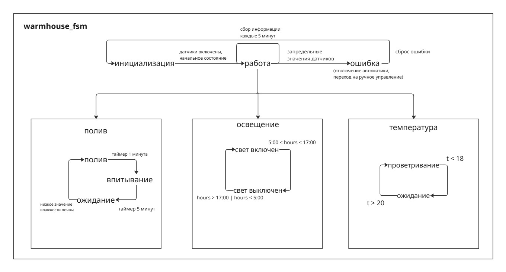

# Warmhouse FSM

Контроллер умной теплицы на базе конечных автоматов (FSM). Сам следит за поливом, светом и проветриванием, а при поломке датчиков безопасно отключает автоматику и передает управление человеку.

## Как это работает
В основе лежит главный автомат (`инициализация` → `работа` → `ошибка`). В режиме `работа` параллельно крутятся три независимых процесса:
* **Полив:** упала влажность → поливаем 1 минуту → ждем 5 минут, пока впитается → проверяем снова.
* **Свет:** горит с 17:00 до 05:00, днем выключен.
* **Температура:** выше 20 °C — открываем проветривание, остыло ниже 18 °C — закрываем.
* **Авария:** если датчик выдал бред — всё выключаем и переходим на ручное управление до нажатия кнопки сброса.

## Стек
* **Контроллер:** ESP32
* **Код:** Rust
* **Датчики:** температура, влажность почвы
* **Нагрузка:** насос, лампа, привод форточки (через реле)

## План
- [x] Нарисовать логику и переходы в Miro
- [ ] Собрать схему на макетке
- [ ] Написать код конечных автоматов
- [ ] Протестировать таймеры и переход в ошибку при отключении датчика
- [ ] Собрать в корпус и запустить в теплице
